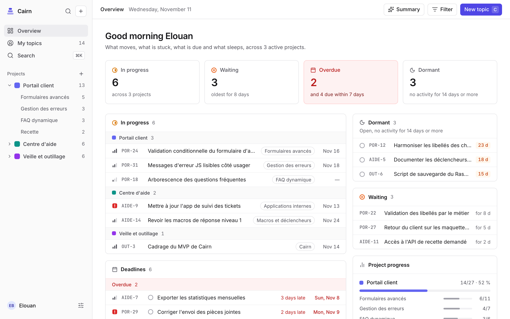
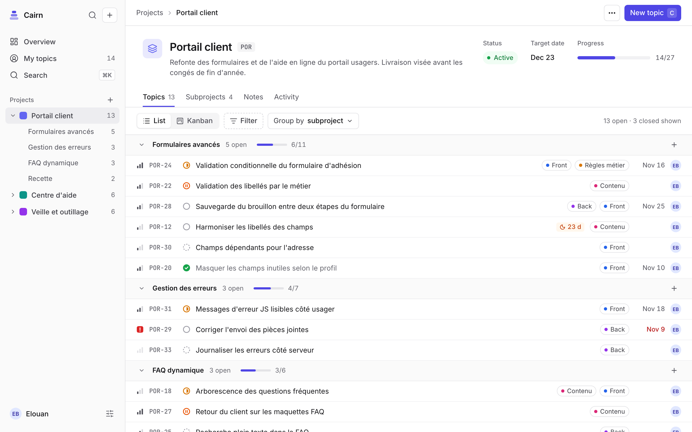
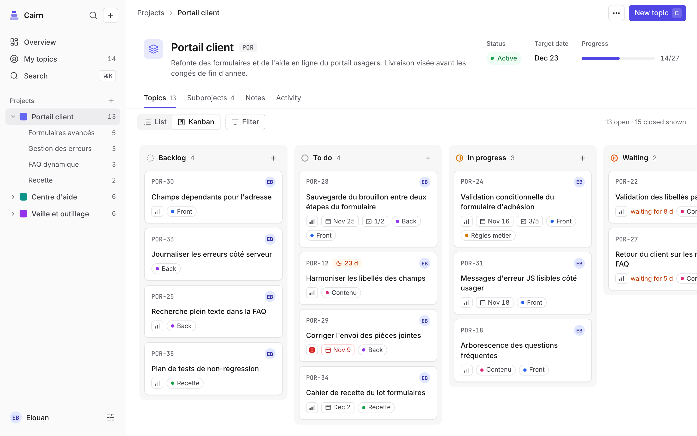
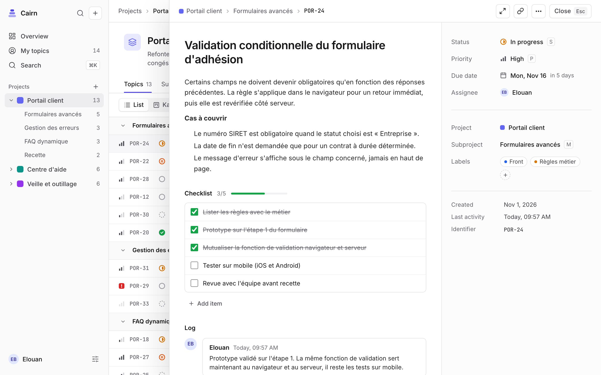
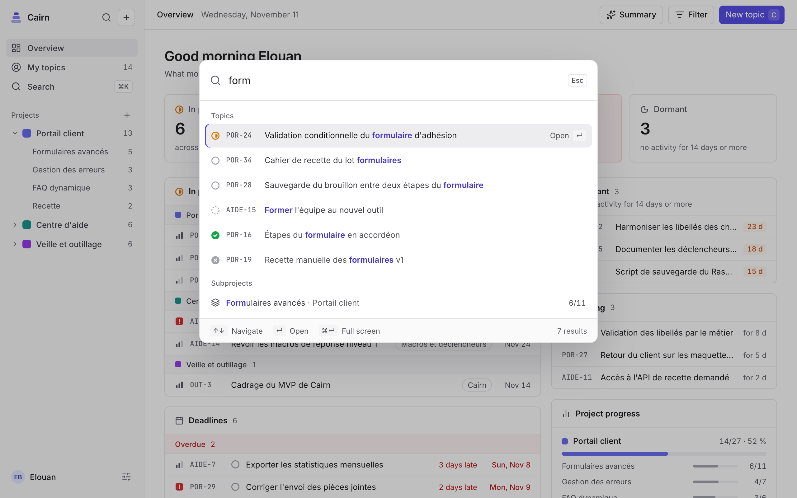

# Cairn

Self-hosted project management for people who run several projects split into subprojects and topics. One
container, one SQLite file, comfortable on a Raspberry Pi 4. Open it and see in five seconds what moves, what is
stuck, what is due and what sleeps.

<picture>
  <source media="(prefers-color-scheme: dark)" srcset="docs/screenshots/overview-dark.png">
  
</picture>

## Install

On a Raspberry Pi 4 (64-bit system) or any amd64 or arm64 host, with Docker:

```sh
mkdir cairn && cd cairn
curl -fsSLO https://raw.githubusercontent.com/OWNER/cairn/main/docker/compose.yaml
docker compose up -d
```

Open `http://<host>:3000`: the first screen creates the administrator account. Data and nightly backups live in
`./data`. To build from source instead: `git clone https://github.com/OWNER/cairn && cd cairn && docker compose up -d --build`.

The [installation guide](docs/installation.md) covers preparing the Pi, configuration, inviting people, backups,
updates and reaching Cairn from outside.

## What it does

- **Projects → subprojects → topics.** Topics have a status, priority, labels, assignee, due date, a Markdown
  description, a checklist, notes and their full history.
- **Overview.** In progress, waiting, overdue and dormant topics across projects, deadlines, progress and recent
  activity, on one page.
- **Fast.** Command palette (Cmd/Ctrl+K), full-text search, keyboard triage (J/K, then S, P, L, M, D to set status,
  priority, labels, subproject or due date), multi-select, drag-and-drop in lists and kanban.
- **For a small team.** Administrators and members, invitations by link, personal API tokens and a REST API
  described in OpenAPI, so scripts and AI assistants can work in it too ([API guide](docs/api.md)).
- **Yours.** Runs on your hardware, JSON export and import, CSV export, nightly backups. English and French, light and
  dark, installable as an app, WCAG 2.1 AA.

|                                                                                                                                                                                                                          |                                                                                                                                                                                                      |
| ------------------------------------------------------------------------------------------------------------------------------------------------------------------------------------------------------------------------ | ---------------------------------------------------------------------------------------------------------------------------------------------------------------------------------------------------- |
| <picture><source media="(prefers-color-scheme: dark)" srcset="docs/screenshots/project-dark.png"></picture>                | <picture><source media="(prefers-color-scheme: dark)" srcset="docs/screenshots/kanban-dark.png"></picture>          |
| <picture><source media="(prefers-color-scheme: dark)" srcset="docs/screenshots/topic-dark.png"></picture> | <picture><source media="(prefers-color-scheme: dark)" srcset="docs/screenshots/palette-dark.png"></picture> |

## Develop

Requirements: Node.js 22 or later, pnpm (or `npx -y pnpm@12.18.0` in place of `pnpm`).

```sh
pnpm install
pnpm dev
```

Open http://localhost:5173 and sign in with a demo account (listed on the sign-in page). The API runs on
http://localhost:3000 and seeds demo data on first start.

```sh
pnpm test        # unit and API tests
pnpm typecheck
pnpm lint
pnpm db:seed     # reset the demo data
pnpm test:e2e    # Playwright journeys and accessibility audit (run `pnpm exec playwright install chromium` once)
```

React 19, Vite, TanStack Router and Query, Tailwind CSS v4 and shadcn/ui on the front; Hono, Zod and OpenAPI,
Drizzle ORM on SQLite on the server. See [architecture](docs/architecture.md) for how it fits together,
[contributing](CONTRIBUTING.md) before a pull request, and the [brief](docs/cadrage.md) (in French) for the product
scope. Changes are listed in the [changelog](CHANGELOG.md).

## License

[GNU Affero General Public License v3.0](LICENSE). You may use, change and share Cairn; if you offer a modified
version as a network service, you must share its source with its users.
